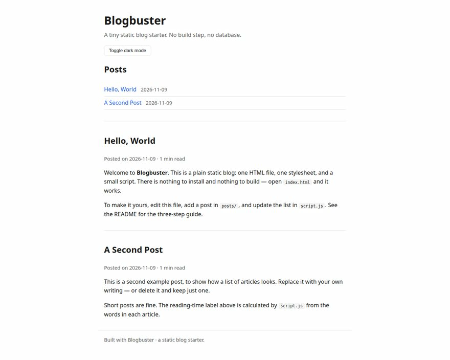

# blogbuster

A simple, working **static blog starter** — plain HTML, CSS and a little
JavaScript. No build step, no server, no dependencies.

## Screenshot



Screenshot captured from the site running locally in a headless browser.
(`screenshot.svg` embeds that capture, so it renders in this README.)

## Run it

Just open `index.html` in a browser, or serve the folder locally:

```bash
# Python 3
python -m http.server 8000
# then visit http://localhost:8000
```

## How to add a post

1. Create a new file in `posts/`, e.g. `posts/my-new-post.md`, following the
   format of `posts/hello-world.md` (a `# Title` line, then your text).
2. Add an entry to the `POSTS` list at the top of `script.js`:

```js
{ slug: "my-new-post", title: "My New Post", date: "2026-11-09" },
```

3. Add a matching `<article>` block in `index.html`, or extend `script.js`
   to render posts from the list (see the comments in `script.js`).

## Files

| File | What it is |
| --- | --- |
| `index.html` | The blog homepage and post content |
| `styles.css` | All styling |
| `script.js` | Post list, reading-time estimate, dark-mode toggle |
| `posts/hello-world.md` | Example post in Markdown |

## License

MIT — do what you like with it.
